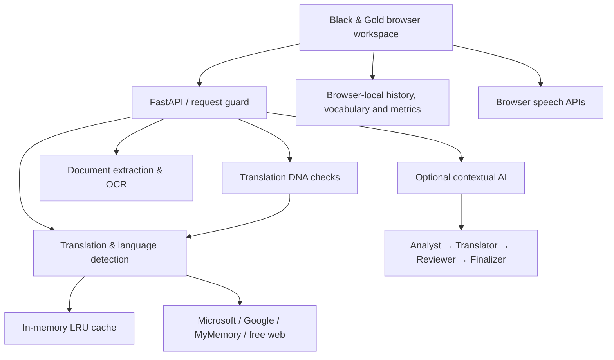
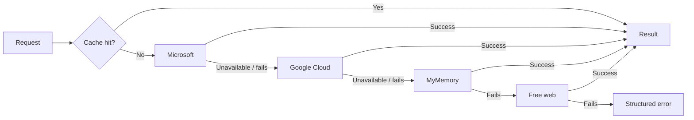

<div align="center">

# ✦ LINGUA AI

### Intelligent Multilingual Communication Studio

*Beyond words. Beyond borders.*


**25 languages · 4 translation engines · 7 focused workspaces**

[Explore features](#workspaces) · [Quick start](#quick-start) · [Architecture](#architecture) · [API reference](#api-reference) · [Testing](#testing)

**CodeAlpha — Artificial Intelligence Internship / Task 01**

</div>

---

## Overview

LINGUA AI evolves a traditional language translation tool into a modular communication studio. It combines real translation providers, optional contextual AI and multi-agent review, document extraction, speech tools, evidence-based translation checks and personal vocabulary practice.

The minimal Black & Gold interface uses a compact navigation rail, animated globe, state-driven feedback and focused workspaces instead of a single long dashboard. Dark mode is the default; light mode and reduced-motion preferences remain supported.

## Workspaces

| Workspace | Capabilities |
|---|---|
| **Translation Studio** | Automatic language detection, live translation, up to five target languages, Roman Urdu/Hindi support, engine selection, speech input and playback, copy, download and sharing |
| **Advanced Intelligence** | Side-by-side provider comparison, contextual translation, tone and style selection, optional four-stage AI review |
| **Multimodal Studio** | TXT, DOCX, text-based PDF and English image OCR; turn-by-turn conversation and microphone level meter |
| **Translation DNA** | Numeric tokens, URLs, placeholders, unchanged text and required terminology checks; optional back translation |
| **Learning & Analytics** | Local flashcards, spaced reviews, actual recorded translation outcomes, provider/language frequencies and JSON export |
| **Translation Library** | Recent translations, favorites, restoration, deletion and undo |
| **Workspace Guide** | Built-in usage guidance |

> The latest interface uses hash-based workspace navigation and retains existing controls in the DOM. Current screenshots will be added after browser verification.

## Architecture



### Translation engine strategy



Auto mode skips unconfigured providers. Transient errors receive a bounded retry; explicitly selected engines do not silently fall back. Free services are quota-limited and may be unreliable.

## Technology stack

| Layer | Technology |
|---|---|
| Backend | Python, FastAPI, Pydantic, httpx |
| Frontend | HTML5, CSS3, vanilla JavaScript ES modules, SVG |
| Translation | Microsoft Translator, Google Cloud, MyMemory, deep-translator |
| Optional AI | OpenAI Chat Completions API |
| Documents | pypdf, defusedxml, Pillow, pytesseract |
| Speech | Web Speech API, Web Audio API |
| Persistence | Browser localStorage, server in-memory cache |
| Quality | pytest, respx, GitHub Actions, Node.js syntax checks |

## Quick start

Python 3.12+ is recommended. Node.js is only needed for JavaScript validation. No frontend build step or Docker is required.

```bash
git clone https://github.com/yasmeenmh90-beep/CodeAlpha_LanguageTranslationTool.git
cd CodeAlpha_LanguageTranslationTool
python -m venv .venv
source .venv/bin/activate
python -m pip install -r requirements.txt
cp .env.example .env
python -m uvicorn app.main:app --reload --port 8000
```

Windows activation: `.venv\\Scripts\\activate`. Copy the environment template with `copy .env.example .env`.

| Resource | Address |
|---|---|
| Application | http://127.0.0.1:8000 |
| Interactive API docs | http://127.0.0.1:8000/docs |

For English image OCR on macOS:

```bash
brew install tesseract
tesseract --version
```

### Configuration

Basic translation works without paid API keys, subject to free-provider availability. Configure optional credentials in the server-side `.env` file; never commit secrets.

| Variable | Purpose |
|---|---|
| `TRANSLATOR_PROVIDER` | Default provider; empty uses automatic fallback |
| `AZURE_TRANSLATOR_KEY`, `AZURE_TRANSLATOR_REGION` | Microsoft Translator |
| `GOOGLE_API_KEY` | Google Cloud Translation |
| `MYMEMORY_EMAIL` | Optional MyMemory quota configuration |
| `CACHE_SIZE` | LRU capacity; 0 disables cache |
| `REQUEST_TIMEOUT` | Provider attempt timeout |
| `OPENAI_API_KEY` | Optional contextual AI credential |
| `LINGUA_AI_MODEL` | Compatible configured chat model |
| `LINGUA_AGENTIC_ENABLED` | Set to 1 to enable four-call review; default 0 |

See [the environment template](.env.example). Optional AI calls may incur charges.

## API reference

| Method | Endpoint | Function |
|---|---|---|
| GET | `/api/health` | Health and configured engines |
| GET | `/api/languages` | Supported languages |
| GET | `/api/providers` | Provider availability and fallback chain |
| GET | `/api/advanced/capabilities` | Optional AI availability |
| POST | `/api/detect` | Language/script detection |
| POST | `/api/translate` | Standard translation |
| POST | `/api/translate/batch` | Multiple target languages |
| POST | `/api/translate/compare` | Explicit provider comparison |
| POST | `/api/translate/contextual` | Context, tone and style |
| POST | `/api/translate/agentic` | Reviewed four-stage translation |
| POST | `/api/extract/{kind}` | Bounded raw file extraction |
| POST | `/api/translation-dna` | Evidence-based checks and optional back translation |

Example:

```bash
curl -X POST http://127.0.0.1:8000/api/translate \\
  -H "Content-Type: application/json" \\
  -d '{"text":"Where is the train station?","source":"auto","target":"fr","provider":"auto"}'
```

The result contains translation text, provider, detected language, cache status and available warnings. Provider outputs may vary.

## Project structure

```text
app/
  main.py           API endpoints and validation
  translators.py    Provider adapters, fallback and cache
  detect.py         Language and script heuristics
  languages.py      Supported language catalog
  agents.py         Four-stage AI orchestration
  documents.py      Text extraction and OCR
  dna.py            Deterministic translation checks
  security.py       Request guards and response headers
static/
  index.html        Seven-workspace interface
  style.css         Black & Gold design and responsive motion
  js/               Browser modules
    workspace.js    Workspace navigation
    app.js          Main translation workflow
    advanced.js     Advanced translation UI
    multimodal.js   Documents and conversation
    dna.js          Translation DNA visualization
    learning.js     Flashcards and analytics
    learning-data.js  Local learning and usage storage
    activity.js     State-driven visual feedback
tests/              API, providers, agents, DNA, documents, security
.github/workflows/ci.yml
requirements.txt
.env.example
```

## Testing

```bash
python -m pytest -q
python -m compileall -q app tests
python -m pip check
for file in static/js/*.js; do
  node --input-type=module --check < "$file" || exit 1
done
```

| Recorded verification | Result |
|---|---|
| Backend suite before compact navigation redesign | 61 passed in 0.72 seconds |
| JavaScript syntax before redesign | 17 modules checked |
| OCR engine on development Mac | Tesseract 5.5.4 installed |

GitHub Actions runs backend tests and module syntax checks. See [current workflow results](https://github.com/yasmeenmh90-beep/CodeAlpha_LanguageTranslationTool/actions). Latest compact UI browser testing, isolated dependency verification and live AI provider validation remain pending. The previous shared Anaconda environment reported unrelated package conflicts; use the isolated virtual environment above.

## Security, privacy & limitations

- Request guard: 60 POST API requests per minute per client IP, 16 concurrent guarded requests per process, 128 KiB JSON/body limit and 5 MiB extraction limit. Security response headers are enabled.
- Credentials remain server-side. Before public deployment, add authentication, gateway-level shared rate limiting, spending controls and hardened file processing.
- Translation and optional AI providers receive submitted text. Browser speech recognition may use a remote speech service. The audio level meter uses local microphone samples.
- Extraction supports UTF-8 TXT, DOCX body text, text-based PDFs (up to 20 pages) and English PNG/JPEG OCR, with a 5,000-character extracted-text limit. Scanned PDFs and original document layout are not supported.
- Translation DNA provides literal evidence checks, not calibrated semantic accuracy scores. Agent roles use the same configured model, and review is not independent verification.
- Learning uses simple review intervals (1 day, doubling up to 90 days; missed cards return after 10 minutes). Up to 500 flashcards and 1,000 standard-workspace analytics outcomes are stored locally. Analytics excludes original text, advanced and conversation modes; saved flashcards and history do contain text.
- Browser data is not cloud-synchronized. Share URLs can include source text; avoid sharing confidential content.
- Conversation is turn-based, not simultaneous interpretation. Free translation providers and browser speech availability vary.

## Development status

Core workspaces, compact navigation, security guard and CI configuration are published on `main`. Final browser smoke tests, live integration checks and updated screenshots are outstanding.

---

<div align="center">

**LINGUA AI** · Built for the CodeAlpha AI Internship

*Language without boundaries.*

[Repository](https://github.com/yasmeenmh90-beep/CodeAlpha_LanguageTranslationTool) · [Report an issue](https://github.com/yasmeenmh90-beep/CodeAlpha_LanguageTranslationTool/issues)

</div>
