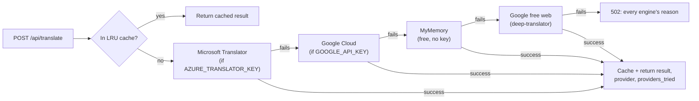

# Language Translation Tool — CodeAlpha AI Internship (Task 1)

A web app where you enter text, choose source and target languages, and get the translation from a real translation API. The result can be copied or read aloud.

## Features

**Translation engine**
- **Fallback chain**: Microsoft Translator → Google Cloud → MyMemory → Google (free web). Each engine is used only if it's configured. On a rate limit, 5xx or network error the engine is retried once, then the next one is tried
- Works with **no API keys**: MyMemory's free API answers out of the box
- **Engine menu** in the header: Auto (chain) or one specific engine. A green dot means the engine is configured, a grey dot means it isn't (with the env var it needs). Your choice is remembered
- **In-memory LRU cache** (500 entries by default): repeated translations don't call the API again and are marked "cached"
- When every engine fails, you get a clear error listing what each one said ("Tried: Microsoft → Google Cloud → MyMemory")
- Up to 5,000 characters, 25 languages. Long text is split automatically for MyMemory's 500-byte request limit

**Translation**
- **Auto-detect** the source language. The result shows as a "Detected: English" badge, in the picker label ("English — detected"), and with a confidence score in the result row
- **Translate as you type** (600 ms debounce) plus a Translate button and `Ctrl/⌘ + Enter`. Stale requests are cancelled with `AbortController`, so an older response never overwrites a newer one
- **Result details**: engine used, "cached" chip, response time in ms, detected language and confidence, and which engines were tried if a fallback happened
- **Alternatives** from MyMemory's translation memory, filtered so they're actually in the target language
- **Translate to multiple languages**: switch on the toggle, pick up to 5 target languages, and get one card per language (each with Copy and Listen)
- **Roman Urdu / Hindi**: type "kia hal hai" with source Urdu (or let auto-detect spot it) and the app offers "Translate as Urdu?". When this is on, the text goes to engines whose auto-detect can read romanized text (Google, Microsoft, free Google), and the result is labelled "from Roman Urdu". MyMemory can't do this, and the app says so instead of returning a bad translation
- **Voice input**: microphone button (Web Speech API) in the source language, with an animated listening state. `Esc` stops it. The button is hidden in browsers without speech recognition
- **File translation**: drag and drop or upload a `.txt` file (≤ 5,000 characters). The download keeps the file's name (`notes.txt` → `notes-fr.txt`)
- **Share link**: copies a URL with `?text=&from=&to=`. Opening it fills in the translator

**Language selection**
- Searchable, keyboard-accessible language picker (ARIA combobox): "Detect language" pinned first, a recently used section, then the full list
- Quick-pick chips for recently used languages above each pane
- Swap button that rotates 180° and swaps both languages and the text pair
- Text direction follows the **script you actually type**: Arabic-script text is right-to-left, Latin text (including romanized Urdu) is always left-to-right
- Last-used source, target and engine are remembered

**Working with results**
- Icon actions with tooltips: **Listen** (text-to-speech with an animated "speaking" state; click again to stop), **Copy** (icon turns into a check mark), **Download as .txt**, **Star**
- Text-to-speech for the input text too
- Text box grows with the content. The character counter turns amber at 90% and red at 100%. Spellcheck and grammar-extension overlays are turned off in the text box
- Shimmer skeleton while loading, and the button shows a spinner and is disabled during the request
- Error banner inside the output pane with a **Retry** button. Common failures (offline, provider not configured, API key rejected, text too long) get a plain-language message, and the backend's own detail is shown below it

**History & favorites**
- Last 20 translations saved in `localStorage`, shown as cards with relative times ("2 min ago")
- Click a card to restore it. Delete single items, or "Clear all" (with Undo)
- **Recent** and **Starred** tabs. Starred items stay when the history rolls over
- When you translate as you type, the steps of the same sentence are merged into one history entry

**Interface**
- Light and dark themes. The first load follows the system setting, and your choice is saved
- Responsive layout (375 px → 1600 px+). On phones the panes stack under a single language row
- Toast notifications (top-right, stacked, auto-dismiss, success/error/info)
- Keyboard shortcuts: `Ctrl/⌘ + Enter` translate, `Ctrl/⌘ + Shift + S` swap, `Ctrl/⌘ + Shift + C` copy, `Esc` closes menus and stops voice input, `?` opens the shortcuts dialog
- Accessibility: semantic HTML, labels on every control, visible focus rings, `aria-live` output, AA contrast in both themes, and `prefers-reduced-motion` support
- Plain HTML/CSS/JavaScript ES modules: no framework, no build step. All user text is rendered with `textContent`, never `innerHTML`

## Screenshots

| Light | Dark |
|---|---|
|  |  |

> Placeholder images. Add `docs/screenshot-light.png` and `docs/screenshot-dark.png`.

## Tech stack

| Layer | Tools |
|---|---|
| Backend | Python, FastAPI, httpx, Pydantic |
| Frontend | HTML, CSS, vanilla JavaScript |
| Translation | Microsoft Translator v3 / Google Cloud Translation v2 / MyMemory / deep-translator |
| Speech | Web Speech API (`speechSynthesis` for listening, `SpeechRecognition` for voice input) |
| Tests | pytest, respx (mocked API calls) |

## Project structure

```
CodeAlpha_LanguageTranslationTool/
├── app/
│   ├── main.py          # FastAPI app and API routes
│   ├── translators.py   # Providers, fallback chain, retry, LRU cache
│   ├── detect.py        # Offline language/script detection (incl. Roman Urdu)
│   └── languages.py     # Supported languages
├── static/
│   ├── index.html       # Markup + inline SVG icon sprite
│   ├── style.css        # Design tokens, light/dark themes, layout
│   └── js/
│       ├── app.js       # Entry point: state, translate flow, events
│       ├── api.js       # Backend client + friendly error mapping
│       ├── picker.js    # Searchable language combobox (single + multi-select)
│       ├── engine.js    # Engine dropdown with status dots
│       ├── voice.js     # Voice input (SpeechRecognition)
│       ├── history.js   # History / starred cards
│       ├── speech.js    # Text-to-speech
│       ├── toast.js     # Toast notifications
│       ├── storage.js   # localStorage helpers
│       ├── dom.js       # DOM helpers (textContent only)
│       └── theme-init.js # Applies the theme before first paint
├── tests/
│   ├── conftest.py      # Isolated env, no backoff, free provider blocked
│   ├── test_api.py      # Original API tests
│   └── test_engines.py  # Chain, cache, detect, batch, MyMemory, Roman Urdu
├── requirements.txt
└── .env.example
```

## Setup

```bash
git clone https://github.com/<your-username>/CodeAlpha_LanguageTranslationTool.git
cd CodeAlpha_LanguageTranslationTool

python -m venv .venv
# Windows: .venv\Scripts\activate
source .venv/bin/activate

pip install -r requirements.txt
cp .env.example .env        # Windows: copy .env.example .env
```

### Choose translation engines (edit `.env`)

**Nothing to configure for a demo.** With no keys, the chain is MyMemory → Google (free web). Add keys to put the better engines first. Every variable is listed in [`.env.example`](.env.example):

| Variable | Purpose |
|---|---|
| `TRANSLATOR_PROVIDER` | Empty = fallback chain (recommended). `microsoft` / `google` / `mymemory` / `free` = use only that engine by default |
| `AZURE_TRANSLATOR_KEY`, `AZURE_TRANSLATOR_REGION` | Microsoft Translator |
| `GOOGLE_API_KEY` | Google Cloud Translation |
| `MYMEMORY_EMAIL` | Optional. Raises MyMemory's free daily quota |
| `CACHE_SIZE` | LRU cache entries (default 500, `0` = off) |
| `REQUEST_TIMEOUT` | Seconds per provider attempt (default 15) |

### Engine chain



Text version: `cache → microsoft → google → mymemory → free → 502`. Rate limits (429), 5xx and network errors get **one retry** with a short backoff before the next engine. Other errors (such as a bad key) move on straight away. Picking a specific engine in the UI, or with `"provider"` in the API, uses only that engine, with no silent fallback.

### How to get a free Microsoft Translator key

The F0 tier is free for 2 million characters a month and needs an Azure account (a card is required for sign-up, but F0 is not charged).

1. Sign in at <https://portal.azure.com> (or create a free account at <https://azure.microsoft.com/free>).
2. Click **Create a resource**, search for **Translator**, and click **Create**.
3. Fill in the form:
   - **Subscription**: your subscription. **Resource group**: create one, e.g. `translator-rg`.
   - **Region**: pick one near you (e.g. `West Europe`), or **Global**.
   - **Name**: any unique name. **Pricing tier**: **Free F0**.
4. Click **Review + create**, then **Create**, and wait for the deployment to finish. Then click **Go to resource**.
5. Open **Keys and Endpoint**. Copy **Key 1** and the **Location/Region** value.
6. In `.env`, set:
   ```env
   AZURE_TRANSLATOR_KEY=<Key 1>
   AZURE_TRANSLATOR_REGION=<Location/Region, e.g. westeurope or global>
   ```
7. Restart the server. The engine menu now shows Microsoft Translator with a green dot, and it is first in the Auto chain.

### Google Cloud Translation key

1. In Google Cloud Console, enable *Cloud Translation API* (billing must be enabled; there is a monthly free allowance).
2. Create an API key under *APIs & Services → Credentials*, and ideally restrict it to the Translation API.
3. Set `GOOGLE_API_KEY=...` in `.env`.

## Run

```bash
uvicorn app.main:app --reload
```

Open http://127.0.0.1:8000. Interactive API docs are at http://127.0.0.1:8000/docs.

## API

| Method | Endpoint | Description |
|---|---|---|
| GET | `/api/health` | Status, default engine and which engines are configured |
| GET | `/api/languages` | Supported language codes and names |
| GET | `/api/providers` | Engines with label, `configured` flag and required env var; the active chain |
| POST | `/api/translate` | Translate text (optional `provider`, `romanized`) |
| POST | `/api/translate/batch` | Translate into up to 5 target languages at once |
| POST | `/api/detect` | Offline language/script detection |

Errors use `{"detail": "..."}`. Validation errors (422) return `detail` as a list. When the engines fail (502), the response also includes `providers_tried` and `errors: [{provider, label, reason}]`.

**Translate** (`provider`: `"auto"` or an engine name; `romanized`: treat Latin text as Roman Urdu/Hindi):

```bash
curl -X POST http://127.0.0.1:8000/api/translate \
  -H "Content-Type: application/json" \
  -d '{"text": "Where is the train station?", "source": "auto", "target": "fr", "provider": "auto"}'
```

```json
{
  "translated_text": "Où est la gare ?",
  "source": "auto",
  "target": "fr",
  "detected_source": "en",
  "provider": "mymemory",
  "providers_tried": ["mymemory"],
  "cached": false,
  "alternatives": ["Où est la gare?", "Où se trouve la gare"],
  "detected_confidence": 0.52,
  "detection_method": "heuristic",
  "romanized": false,
  "suggest_romanized": false,
  "warnings": []
}
```

**Engines:**

```bash
curl http://127.0.0.1:8000/api/providers
```

```json
{
  "default": "auto",
  "chain": ["mymemory", "free"],
  "providers": [
    {"name": "microsoft", "label": "Microsoft Translator", "configured": false, "requires": "AZURE_TRANSLATOR_KEY"},
    {"name": "google", "label": "Google Cloud Translation", "configured": false, "requires": "GOOGLE_API_KEY"},
    {"name": "mymemory", "label": "MyMemory", "configured": true, "requires": null},
    {"name": "free", "label": "Google (free web)", "configured": true, "requires": null}
  ]
}
```

**Batch** (max 5 targets; duplicates are removed; each target succeeds or fails independently):

```bash
curl -X POST http://127.0.0.1:8000/api/translate/batch \
  -H "Content-Type: application/json" \
  -d '{"text": "Good morning", "source": "en", "targets": ["fr", "es"]}'
```

```json
{
  "source": "en",
  "results": [
    {"target": "fr", "ok": true, "result": {"translated_text": "Bonjour", "provider": "mymemory", "...": "..."}, "error": null},
    {"target": "es", "ok": true, "result": {"translated_text": "Buenos días", "provider": "mymemory", "...": "..."}, "error": null}
  ]
}
```

**Detect** (an offline heuristic: Unicode script blocks plus stop-word scoring; it also flags romanized Urdu):

```bash
curl -X POST http://127.0.0.1:8000/api/detect \
  -H "Content-Type: application/json" \
  -d '{"text": "mujhe pani chahiye"}'
```

```json
{"language": "ur", "name": "Urdu", "confidence": 0.99, "script": "Latin", "romanized": true, "method": "heuristic"}
```

## Tests

```bash
pytest -q
```

There are 46 tests. All HTTP calls are mocked with `respx`, and the `requests`-based free provider is blocked in `conftest.py`, so the tests never touch the network. They cover:
- validation
- each provider's request and response handling
- the fallback chain (429 → next engine, retry once, no retry on 403, pinned engines don't fall back)
- the 502 listing every engine's reason
- cache hits and LRU eviction
- `/api/providers`, `/api/detect` and `/api/translate/batch` (including the >5-targets 422)
- MyMemory parsing (entities, alternatives, wrong-language matches, quota, chunking)
- HTML-entity decoding
- Roman Urdu

## Notes

- **MyMemory** is a translation memory plus machine translation. Quality varies, and its anonymous quota is about 5,000 characters a day (more with `MYMEMORY_EMAIL`). For real use, add a Microsoft or Google key.
- **Google (free web)** uses an unofficial endpoint that often rate-limits servers. It's the last resort in the chain.
- **Language detection** for engines that don't report it (MyMemory, free Google) uses the offline heuristic in `app/detect.py`, and is labelled `"detection_method": "heuristic"`.
- **Voice input** uses the browser's speech recognition. Chrome sends the audio to Google's servers, so it needs a connection. Firefox doesn't support it, so the mic button is hidden there.
- Text-to-speech uses the voices installed on your device. Chrome and Edge have the widest language coverage.
- API keys stay on the server and are never sent to the browser.


## LINGUA AI multimodal studio

Install the updated Python requirements. For English image OCR on macOS, install Tesseract with `brew install tesseract`. OCR runs on the application server, not in the browser. PDF extraction supports text-based PDFs, not scanned PDFs; DOCX extraction returns plain body text, not original layout. Uploads are limited to 5 MB and extracted text to 5000 characters. Review extracted text before transferring it into the translator, which may automatically send it to external translation providers. Browser speech recognition may use a remote browser speech service. The microphone level meter uses local audio samples and requires a secure browser context (localhost or HTTPS). Conversation turns are held in the current page only.
